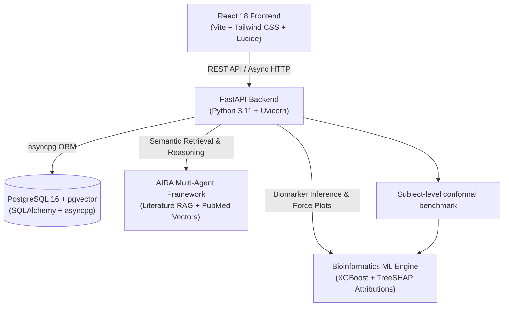

# ADAM-1 Enhanced

**AI-Powered Alzheimer's Disease and Microbiome Research Platform**

[](./docs/)
[](./docs/)

---

## Overview

ADAM-1 Enhanced is a full-stack research platform built on top of the original [ADAM-1 research framework](https://doi.org/10.1109/ACCESS.2025.3599857) (University of Massachusetts, 2025). It transforms the original Jupyter notebook-based pipeline into a modular, API-first web application for Alzheimer's Disease and microbiome data analysis with Explainable AI (TreeSHAP) and multi-agent reasoning (AIRA).

### Architecture



---

## Deployment with Render (Blueprint)

This repository includes a production-ready Render Blueprint specification ([`render.yaml`](./render.yaml)) to deploy the complete 3-tier architecture with a single click.

### Services Deployed by the Blueprint

1. **`adam-enhanced-backend`** (Web Service):
   - **Runtime:** Python 3.11
   - **Framework:** FastAPI + Uvicorn
   - **Health Check:** `/api/health`
   - **Auto-Initialization:** Auto-migrates database schemas, verifies extensions (`vector`, `pg_trgm`, `uuid-ossp`), and ingests the 335 cohort samples on first startup.

2. **`adam-enhanced-frontend`** (Static Site):
   - **Runtime:** Node.js 20 / Static
   - **Build Command:** `npm ci && npm run build`
   - **Publish Directory:** `./dist`
   - **Routing:** Automatic SPA fallback rewrite (`/* -> /index.html`)
   - **API Connection:** Dynamically connected to `adam-enhanced-backend` host.

3. **`adam-enhanced-db`** (Managed PostgreSQL 16):
   - **Version:** PostgreSQL 16
   - **Extensions:** `pgvector`, `pg_trgm`, `uuid-ossp`

### Step-by-Step Render Deployment Guide

1. **Push your code to GitHub:**
   ```bash
   git add .
   git commit -m "Configure Render Blueprint deployment"
   git push origin main
   ```

2. **Create a Blueprint Instance in Render:**
   - Log in to your [Render Dashboard](https://dashboard.render.com/).
   - Click **New +** → **Blueprint**.
   - Connect your GitHub repository (`ADAM-project` or `ADAM-Enhanced`).
   - Render will parse `render.yaml` and display the 3 resources to be provisioned.

3. **Configure Environment Secrets:**
   - When prompted for `GROQ_API_KEY`, paste your Groq API key (free tier available at [console.groq.com](https://console.groq.com)).
   - Click **Apply**.

4. **Automatic Deployment & Verification:**
   - Render provisions PostgreSQL, builds the FastAPI backend, and deploys the React frontend.
   - Once deployment completes, your frontend URL (`https://adam-enhanced-frontend.onrender.com`) is live!

---

## Local Development & Docker

### Run with Docker Compose (Recommended)

```bash
# 1. Clone and enter project
git clone https://github.com/Narasimhamanam/ADAM-project.git
cd ADAM-project

# 2. Set up environment
cp .env.example .env
# Edit .env and insert your GROQ_API_KEY

# 3. Start all 3 containers (Database, Backend, Frontend)
docker compose up -d

# 4. Verify health
curl http://localhost:8000/api/health

# 5. Open in browser
# Frontend: http://localhost:3000
# Backend Docs: http://localhost:8000/docs
```

### Local Manual Development

**Backend:**
```bash
cd backend
python -m venv .venv
source .venv/bin/activate  # Windows: .venv\Scripts\activate
pip install -r requirements.txt
uvicorn app.main:app --reload --port 8000
```

**Frontend:**
```bash
cd frontend
npm install
npm run dev
# → http://localhost:5173
```

---

## API Reference

| Method | Endpoint | Description |
|---|---|---|
| `GET` | `/api/health` | System health check (DB connectivity & uptime) |
| `GET` | `/api/system/info` | Runtime environment information |
| `GET` | `/api/datasets` | Paginated dataset metadata registry |
| `GET` | `/api/samples/{id}` | Single patient clinical microbiome record |
| `GET` | `/api/ml/benchmark` | 30-Seed cross-validation model benchmarks |
| `POST` | `/api/ml/predict` | Live Alzheimer's risk prediction (XGBoost) |
| `GET` | `/api/ml/shap/global` | Global Mean \|SHAP\| biomarker rankings |
| `GET` | `/api/ml/shap/sample/{id}` | Sample-level local TreeSHAP attribution forces |
| `GET` | `/api/trajectory/subjects` | Longitudinal subjects registry (102 subjects, visit counts) |
| `GET` | `/api/trajectory/subjects/{id}` | Longitudinal AD risk trajectory (baseline, latest, slopes, SHAP) |
| `GET` | `/api/trajectory/subjects/{id}/sample/{smp}/literature` | Grounded PubMed RAG literature for trajectory observation |
| `POST` | `/api/trajectory/compare` | Side-by-side longitudinal trajectory comparison |
| `GET` | `/api/trajectory/evaluation` | Cohort-level coverage and zero subject-leakage audit |
| `GET` | `/api/trajectory/capabilities` | Architecture capabilities and time-to-event governance status |
| `GET` | `/api/ai/literature/search` | Search over verified, locally indexed publication summaries |
| `POST` | `/api/ai/agent/execute` | 3-Tier AIRA Multi-Agent execution workflow |

Full interactive API docs: `http://localhost:8000/docs` (Swagger UI)

---

## Application Pages & Phase Status

| Page | Route | Status | Phase |
|---|---|---|---|
| **Dashboard** | `/dashboard` | ✅ Complete | Phase 1 |
| **Settings** | `/settings` | ✅ Complete | Phase 1 |
| **Dataset Explorer** | `/datasets` | ✅ Complete | Phase 2 |
| **Alzheimer Analysis** | `/alzheimer` | ✅ Complete | Phase 3 |
| **Risk Trajectory** | `/trajectory` | ✅ Complete | Phase 3 |
| **ML Risk Prediction** | `/ml` | ✅ Complete | Phase 3 |
| **Model Comparison** | `/models` | ✅ Complete | Phase 3 |
| **SHAP Explainability** | `/shap` | ✅ Complete | Phase 3 |
| **Reports & PDF** | `/reports` | ✅ Complete | Phase 3 |
| **Research Assistant** | `/assistant` | ✅ Complete | Phase 4 |
| **Literature / RAG** | `/literature` | ✅ Complete | Phase 4 |
| **AI Agents** | `/agents` | ✅ Complete | Phase 4 |

---

## 🧪 Automated Test Suite & Verification

Run the backend tests from `backend/` after installing `requirements.txt`:

```bash
python -m pytest tests -q
```

From `frontend/`, run `npm ci`, `npm run lint`, `npm run build`, and
`node scripts/test_trajectory_frontend.cjs`. If you only need the application
build, set `PUPPETEER_SKIP_DOWNLOAD=true` before installing dependencies. PDF
generation requires a browser. To check a running deployment, confirm
`GET /api/health` reports both `status: healthy` and `database: connected`.
Set `CORS_ORIGINS` to the actual frontend origin when deploying.

## Subject-level conformal benchmark

The research API compares the full XGBoost predictor with a compact model and
two ways of calibrating prediction sets. It fits and tests on disjoint subject
groups, computes aggregate coverage and abstention, and does not need
PostgreSQL or a language model key. Query the live comparison through Swagger
or run the same evaluation locally:

```bash
curl "http://localhost:8000/api/research/benchmark/subject-conformal?mode=compact_subject"
cd backend
python -m app.research.run_subject_benchmark --output research-benchmark.json
```

The API also accepts `baseline`, `visit_conformal`, `subject_conformal`,
`compact_only`, and `all` (default). The CLI runs all modes by default and
accepts `--mode` to run one. See [research notes](RESEARCH_PAPER_NOTES.md) for
the methods, measured results and limitations, and [changelog](CHANGELOG.md)
for the repository audit.

---

## Longitudinal Risk Trajectory & Research Governance

The platform incorporates a **Longitudinal AD-Associated Risk Trajectory** module that tracks how model-estimated AD probability evolves over observed study days (up to 311 days):
- **Subject-Level Integrity:** Observations are strictly partitioned and grouped by `study_id` (102 subjects, 335 samples).
- **Zero Subject Leakage:** Evaluated with subject-level splitting to strictly eliminate longitudinal data leakage.
- **Empirical Trajectory vs Future Forecasting:** The system characterizes changes across observed research visits. It **does not fabricate future onset dates** or clinical diagnoses. The cohort contains repeated measurements but exactly zero observed Control → AD disease transitions; validated survival forecasting will be added in future work when transition cohorts become available.
- **Detailed Documentation:** See [`docs/LONGITUDINAL_AD_RISK_TRAJECTORY.md`](./docs/LONGITUDINAL_AD_RISK_TRAJECTORY.md).

---

## Research Integrity & Citation

This platform is inspired by and built upon:

> Huang, Z., Sekhon, V. K., Sadeghian, R., Vaida, M. L., Jo, C., McCormick, B. A., Ward, D. V., Bucci, V., & Haran, J. P. (2025). ADAM-1: An AI reasoning and bioinformatics model for Alzheimer's disease detection and microbiome-clinical data integration. *IEEE Access, 13*, 145953–145967. https://doi.org/10.1109/ACCESS.2025.3599857

---

© 2026 ADAM-1 Enhanced Project


## Rigor Suite on PR #2

Open `/rigor` for executed leakage, calibration and SHAP-stability artifacts.
The supplied patch's visit-pooled conformal scores were corrected to subject maxima.
Repeated full/compact comparisons distinguish feature compression from calibration.

```bash
cd backend
python -m app.research.rigor
python -m app.research.repeated --seeds 30 --permutations 199 --bootstrap 1000 --trials 5
python -m pytest tests -q
cd ../frontend
npm run lint
npm run build
node scripts/test_trajectory_frontend.cjs
cd ..
python manuscript/generate.py
cd manuscript
latexmk -pdf -interaction=nonstopmode -halt-on-error main.tex
```

See [results](docs/REPEATED_RESULTS.md), [verified literature and CFP dates](docs/RESEARCH_ROADMAP.md),
[external validation limitations](docs/EXTERNAL_VALIDATION.md), and
[optional DB/Render recovery](docs/OPTIONAL_DATABASE.md). Database unavailability
does not prevent file-backed research; persistence still requires a working DB.
The manuscript is an ACM-format research draft, not a promise of acceptance.
